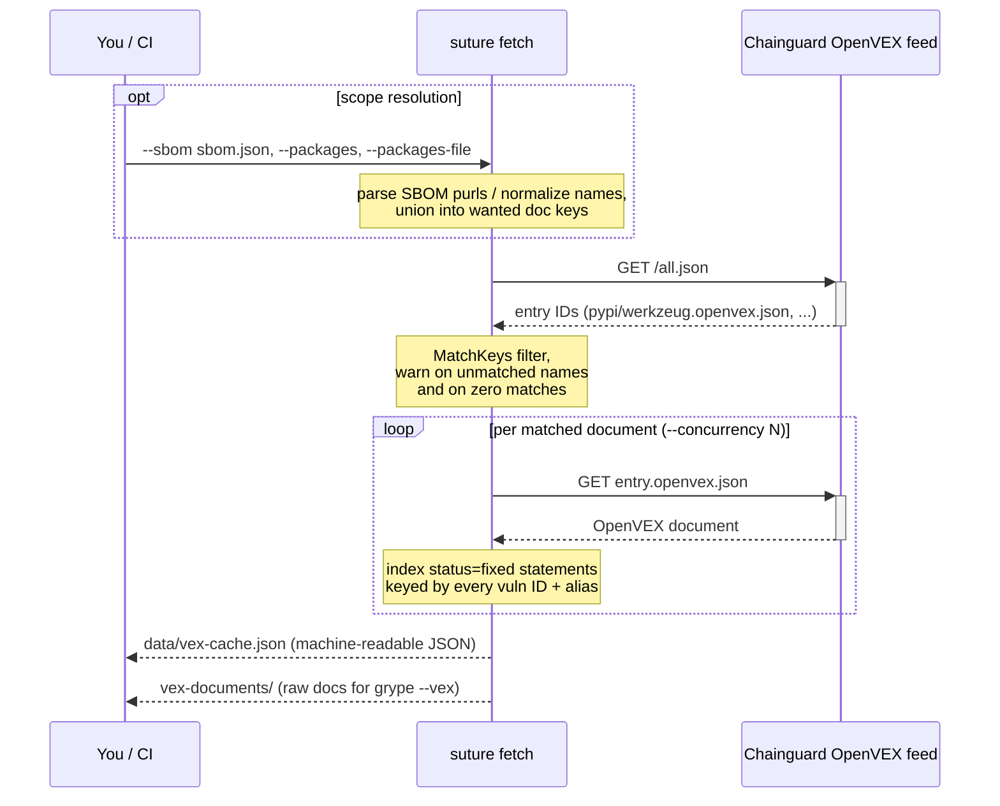
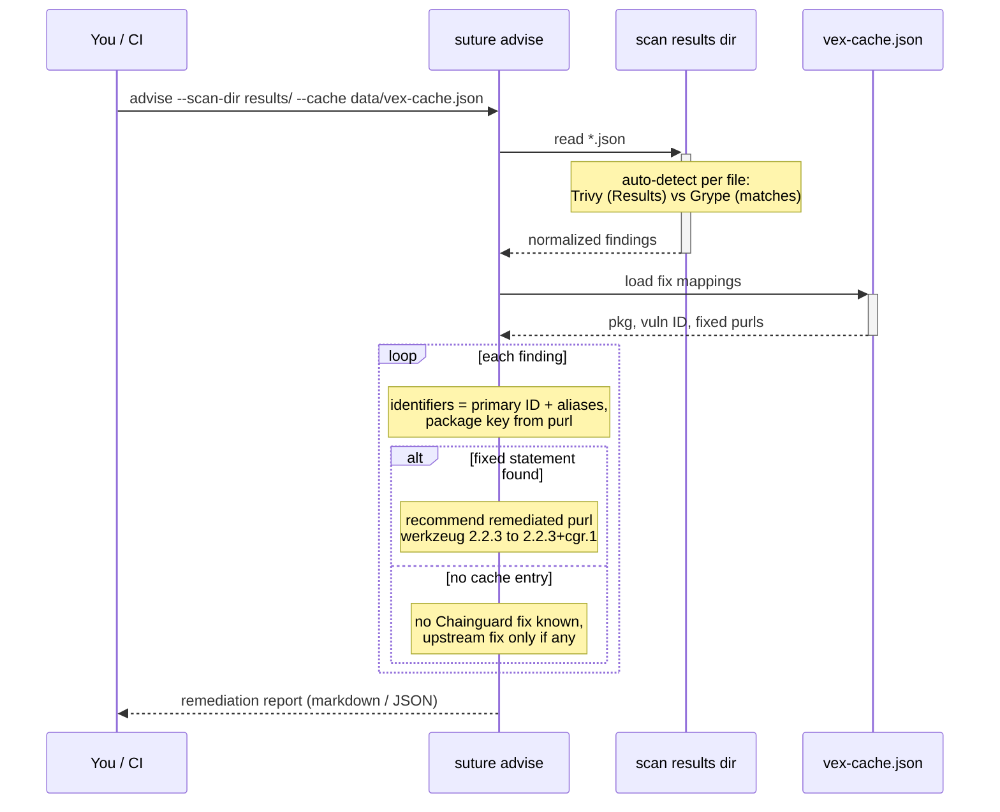

# suture

**Turn supplier OpenVEX into remediation plans your existing tools can act on.**

[](https://github.com/mental-lab/suture/actions/workflows/ci.yml)
[](https://github.com/mental-lab/suture/releases)
[](https://goreportcard.com/report/github.com/mental-lab/suture)

Suture is a deterministic OpenVEX remediation bridge. It cross-references
Trivy/Grype findings against the Chainguard OpenVEX feed, identifies
**same-upstream-version backports** (`+cgr.N` and `-0.cgr.N`), and emits a
machine-readable remediation plan. Suture can also materialize raw OpenVEX for
compatible scanners. The remediation plan is intended for policy engines,
integration adapters, approved coding agents, and reviewable manifest changes.

Suture does not replace Dependabot, Renovate, an SCA platform, or repository
approval rules. It supplies the vendor-specific evidence those tools do not
currently derive from Chainguard OpenVEX.

Feed compatibility is based on the **feed shape**, not the operator. Any
OpenVEX feed laid out like Chainguard Libraries' can be configured with
`--base-url`. Chainguard Libraries is the default because it publishes public,
machine-readable remediation data in that format.

## See it in action

[chainguard-swag-shop](https://github.com/mental-lab/chainguard-swag-shop) is
an intentionally vulnerable Flask shop wired to suture in CI. The advisor
reports a cross-version Chainguard fix honestly as an upgrade rather than
mislabeling it a same-version backport:

```
| CVE | Severity | Package | Chainguard fix | Action |
| --- | --- | --- | --- | --- |
| GHSA-2g68-c3qc-8985 | HIGH | `werkzeug 2.2.3` | werkzeug==3.0.2+cgr.1 | **upgrade** |
```

The repo walks the full story: build → test → scan → advise → policy gate
(red on vulnerable `main`), then green on the remediated branch.

## Status

Suture is a pre-1.0 project. Available today:

- **fetch** — pull per-package OpenVEX documents into a machine-readable fix
  cache, scoped to what you ship (`--sbom` / `--packages` / `--packages-file`)
  or the full feed
- **advise** — per-finding remediation recommendation (backport /
  upgrade-or-replace / exception-review / already-fixed), reading Trivy and
  Grype output interchangeably, scoped to Chainguard Libraries ecosystems
- **github-advisory export** — produce an OSV 1.4 request body for
  GitHub Enterprise innersource advisories and Dependabot
- **fix** — dry-run by default; applies supported exact pins from the advisor's
  structured `fix_purl` contract to requirements files, package.json, and
  literal Maven dependency versions
- **mcp** — optional read-only evidence tools for Copilot and other approved
  coding agents; not an automation or authorization path
- **Releases** — cosign keyless-signed, SBOM'd, multi-arch binaries and
  Chainguard-based container images

Next integration targets: artifact verification, Maven property/BOM handling,
and Gradle support. Each belongs behind the same machine-readable
remediation-plan boundary.

## Install

```sh
# Release binary
curl -sSfL https://github.com/mental-lab/suture/releases/latest/download/suture_$(uname -s | tr '[:upper:]' '[:lower:]')_$(uname -m | sed 's/x86_64/amd64/;s/aarch64/arm64/').tar.gz | tar xz suture
sudo install suture /usr/local/bin/

# Container (CI-friendly, runs on Wolfi-based Chainguard images)
docker run --rm -v "$PWD":/work -w /work ghcr.io/mental-lab/suture:latest --help

# From source
go install github.com/mental-lab/suture@latest
```

## Execution flow

### `fetch`



### `advise`



## Commands

### `fetch` — build the fix cache

```sh
suture fetch --out data/vex-cache.json
suture fetch --out data/vex-cache.json --write-docs vex-documents

# Scope the fetch to the packages you ship (flags compose as a union):
suture fetch --sbom sbom.json --write-docs vex-documents        # Syft/SPDX/CycloneDX
syft . -o syft-json | suture fetch --sbom -                     # or via stdin
suture fetch --packages werkzeug,flask                          # bare names, any ecosystem
suture fetch --packages pypi/werkzeug,npm/lodash                # eco/name pins one
suture fetch --packages-file requirements.txt                   # one per line; pins stripped
```

Fetches every per-package OpenVEX document and emits a machine-readable cache:

```json
{ "pkg:pypi/werkzeug": { "CVE-2023-25577": ["pkg:pypi/werkzeug@2.2.3%2Bcgr.1"] } }
```

Only `status: fixed` statements are indexed, keyed by **every** vulnerability
identifier (CVE, GHSA, …) so both Trivy- and Grype-reported IDs match.
`--write-docs` also materializes the raw documents for Grype's `--vex <dir>`
(VEX-aware scanning that suppresses fixed findings).

Without a scoping flag the whole feed is fetched. With one, only documents
for your packages are pulled; requested names that match nothing in the feed
are warned about, and a zero-match scope warns loudly since an empty cache
leaves the gate with nothing to enforce.

### `advise` — recommend a remediation path per finding

```sh
suture advise --scan-dir results/ --format markdown --out vex-report.md
suture advise --scan-dir results/ --assets security/asset-inventory.yaml --gate
```

Reads **Trivy and Grype** JSON (auto-detected per file; place output from both
scanners in the same directory), looks each finding up in the feed, and decides:

- **backport** — a Chainguard-built package is marked `status=fixed` at the
  same upstream base version; this avoids an upstream version upgrade but
  still requires normal validation
- **upgrade-or-replace** — no backport coverage; internet-facing Critical/High
- **exception-review** — no backport, lower risk context
- **none** — the backport is already applied (installed == fixed version)

`--gate` exits 1 when an internet-facing Critical/High finding has an
unapplied same-upstream-version backport. The gate passes after the backport
is applied.

### `fix` — optionally apply supported exact pins

```sh
suture advise --scan-dir results/ --format json --out remediation-plan.json
suture fix --from remediation-plan.json                         # dry run
suture fix --from remediation-plan.json --write --out summary.md
```

The built-in updater is deliberately narrow. It handles exact PyPI and npm
pins and literal Maven dependency versions. It does not currently update Maven
properties, parents, BOMs, transitive constraints, Gradle files, or version
catalogs. A same-base backport reduces upgrade risk; it is not a compatibility
guarantee.

### `github-advisory export` — prepare native GitHub advisory input

```sh
suture advise --scan-dir results/ --format json --out remediation-plan.json
suture github-advisory export \
  --from remediation-plan.json --out github-advisories.json
```

The exporter emits the OSV 1.4 request body for GitHub Enterprise innersource
advisories. It does not upload or handle credentials. See
[enterprise adoption](docs/guides/enterprise-adoption.md) for prerequisites
and the GitHub App upload step.

## CI usage (GitHub Actions)

```yaml
- name: Install suture
  run: |
    curl -sSfL https://github.com/mental-lab/suture/releases/latest/download/suture_linux_amd64.tar.gz \
      | tar xz suture
    sudo install suture /usr/local/bin/

- name: Build OpenVEX fix cache (scoped to the app's packages)
  run: suture fetch --sbom sbom.json --out data/vex-cache.json --write-docs vex-documents

- name: Remediation plan and gate
  run: |
    suture advise --scan-dir results/ \
      --assets security/asset-inventory.yaml \
      --format json --out remediation-plan.json \
      --gate
```

## Supply chain

Every release includes:

- **Cosign keyless-signed** checksums (`checksums.txt.sig` / `.pem` per release)
- **SBOM** attached to every archive
- **Container images** built on `cgr.dev/chainguard/static` — multi-arch,
  minimal, zero-CVE base

## What suture doesn't promise

A green gate means no *in-scope* finding meets the configured blocking rule.
It says nothing about ecosystems outside the feed, scanners' blind spots,
packages you did not scan, artifact availability, or application
compatibility. Suture is a remediation bridge, not a scanner, complete
package manager, or merge authority. See
[scope and disclaimer](docs/trust/scope-and-disclaimer.md).

## Documentation

[Full documentation index →](docs/README.md)

- [Quickstart](docs/getting-started/quickstart.md) — install, first fetch, first gate
- [Concepts](docs/concepts/decision-framework.md) — OpenVEX backports, the fix cache, the decision framework
- [Enterprise adoption](docs/guides/enterprise-adoption.md) — integrate with existing scanners, GitHub, Dependabot, and Copilot
- [CLI reference](docs/reference/cli.md) — every command and flag
- [Optional Copilot integration](docs/guides/ai-assistants.md) — the MCP server and its read-only tools
- [Changelog](CHANGELOG.md) — user-facing release notes
- [Scope & disclaimer](docs/trust/scope-and-disclaimer.md) — what suture does and does not claim
